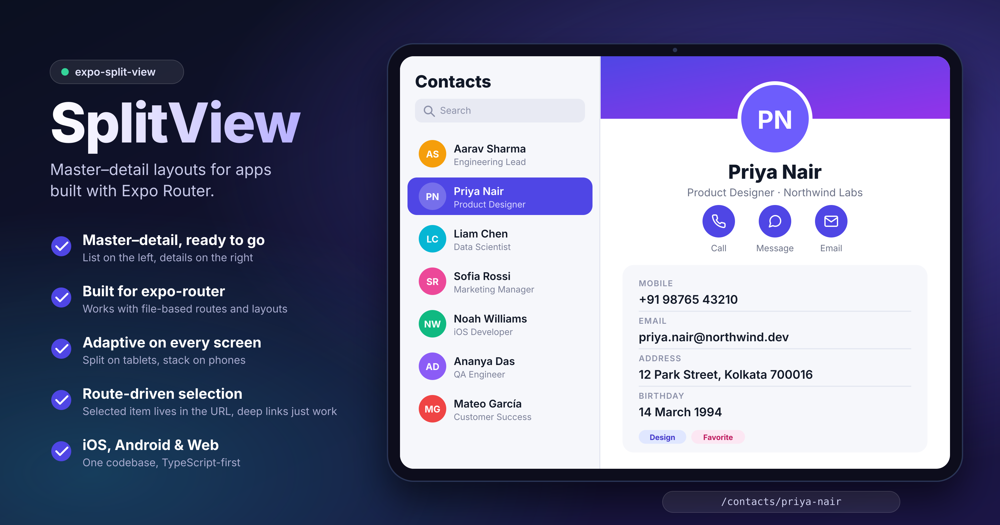
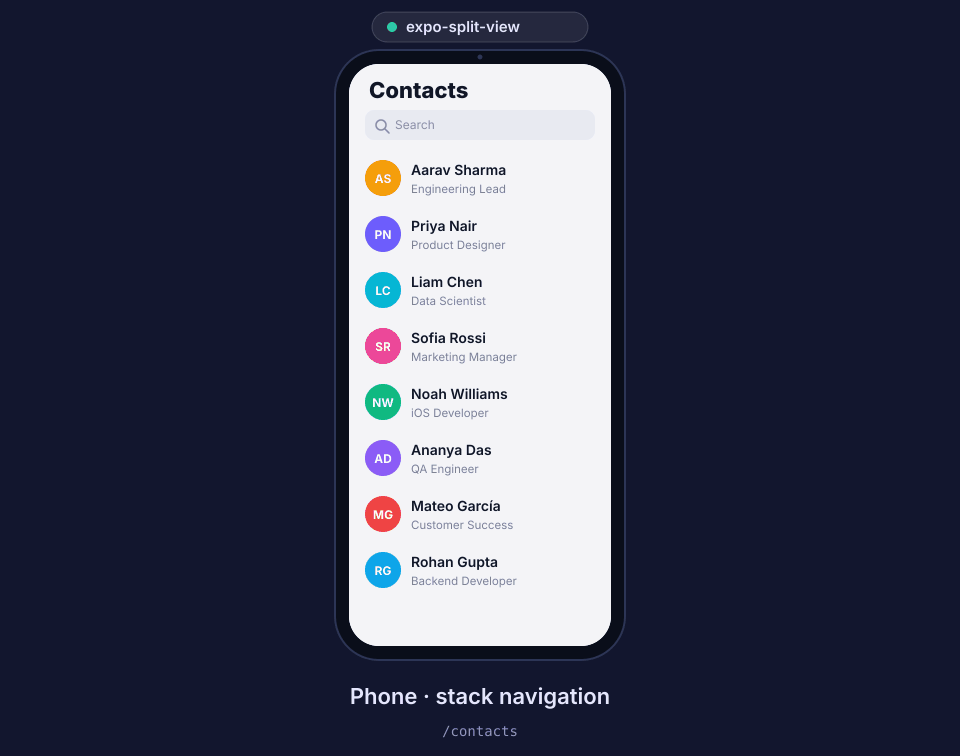

<div align="center">

# expo-split-view

**Split-view layouts for Expo apps, built for [expo-router](https://docs.expo.dev/router/introduction/).**

[](https://www.npmjs.com/package/expo-split-view)
[](https://www.npmjs.com/package/expo-split-view)
[](https://www.npmjs.com/package/expo-split-view)
[](https://github.com/Inocentum-Technologies/expo-split-view/actions)
[](./LICENSE)
[](https://github.com/Inocentum-Technologies/expo-split-view/stargazers)
[](https://inocentum-technologies.github.io/expo-split-view/)
[](https://docs.expo.dev/router/introduction/)
[](https://github.com/Inocentum-Technologies/expo-split-view/pulls)



[**Documentation**](https://inocentum-technologies.github.io/expo-split-view/) ·
[**Report a Bug**](https://github.com/Inocentum-Technologies/expo-split-view/issues) ·
[**Request a Feature**](https://github.com/Inocentum-Technologies/expo-split-view/issues)

</div>

---

> [!IMPORTANT]
> This module works with **expo-router only**. `react-navigation` (standalone) is not supported.

Adaptive master-detail split-view architecture for **Expo Router**. Seamlessly transitions between tablet master-detail layout and full-screen mobile stack navigation without unmounting components or losing state.

Supports **Android**, **iOS**, and **Web**, and works in **Expo Go** out of the box with zero native build dependencies.

## 📖 Documentation

Full documentation, API reference, and guides are hosted here:

👉 **https://inocentum-technologies.github.io/expo-split-view/**

---

## Features

- **Adaptive Split Layout:** Automatically presents a side-by-side master-detail pane on tablets, desktops, and wide viewports, and transitions to a native full-screen stack on mobile phones.
- **State Preservation Across Form Factors:** Screens and inputs remain mounted when rotating between orientations or unfolding foldable devices. Form input values, search queries, and scroll positions are preserved.
- **Smart Responsive Navigation (`useSplitView`):** The `navigate` helper automatically executes `router.replace` on tablets (dismissing any deep subpage history to avoid pile-up) and `router.push` on phones (preserving native back history).
- **Left Sidebar Header & Outer Back Navigation:** Optional built-in or custom header for the master pane on tablet that coordinates with the outer navigator (`canGoBack` / `goBack`), safely popping the screen hosting the split view without interfering with right-pane navigation.
- **Safe Area Inset Management:** Configurable edge insets via `safeAreaEdges` that safely clear landscape cutouts and home indicators while preventing double status-bar top padding in Expo Router stacks.
- **Resilient Mobile Back Navigation:** Intervenes only on mobile when `router.replace` on a tablet leaves the phone stack without a root `index` screen in history. Automatically injects a header back button, listens to the Android hardware back button, and binds edge-swipe gestures.
- **Compound Component API:** Provides clean, declarative compound components (`<SplitView>`, `<SplitView.Placeholder>`, `<SplitView.Detail>`) as well as direct named exports.
- **Expo Go & Web Ready:** Built using standard React Native and Expo Router primitives with zero native build dependencies.

---

## Demo

 

---

## How It Works

```text
+-----------------------------------------------------------------------------------+
| TABLET VIEW (width >= 768)                                                        |
| +------------------------------------+------------------------------------------+ |
| | LEFT PANE (MasterList - width: 320)| RIGHT PANE (<Stack /> navigation)        | |
| |                                    |                                          | |
| | [Item A] (Active) --------------> | Shows: app/items/[id]             | |
| | [Item B]                           | (or placeholder if no item is selected)  | |
| | [Item C]                           |                                          | |
| +------------------------------------+------------------------------------------+ |
+-----------------------------------------------------------------------------------+

+-----------------------------------------------------------------------------------+
| MOBILE VIEW (width < 768)                                                         |
| +-------------------------------------------------------------------------------+ |
| | MasterList stays mounted in background (display: 'none', width: 0).           | |
| | The <Stack /> occupies 100% of the screen:                                    | |
| |                                                                               | |
| | 1. Stack Root (index.tsx)     ==>  Renders MasterList full-screen             | |
| | 2. Tap item                   ==>  navigate('/items/[id]')             | |
| | 3. Detail screen ([id].tsx)   ==>  <SplitView.Detail> provides safe back      | |
| +-------------------------------------------------------------------------------+ |
+-----------------------------------------------------------------------------------+
```

---

## Installation

```bash
npx expo install expo-split-view
```

### Expo Config Plugin (Optional)

Add the plugin to your `app.json` to automatically enable iPad / tablet multitasking support (`ios.supportsTablet: true`) in native builds:

```json
{
  "expo": {
    "plugins": ["expo-split-view"]
  }
}
```

---

## Quick Start

A recommended file structure for a split-view route group looks like this:

> [!NOTE]
> `expo-split-view` works in **any Expo Router route group** — inside a tab layout, as a standalone stack, or nested within a drawer. A tab layout is not required but is fully supported. Common use cases include:
> - A tab inside `app/(tabs)/items/` — split view as one tab among many
> - A standalone stack at `app/items/` — no tabs at all
> - Nested inside a drawer at `app/(drawer)/items/`

```text
app/
  items/
    _layout.tsx       <-- Layout coordinator (<SplitView>)
    index.tsx         <-- Root index screen (<SplitView.Placeholder>)
    [id]/
      index.tsx       <-- Detail screen (<SplitView.Detail>)
components/
  MasterList.tsx      <-- Shared master list with useSplitView()
```

### 1. Route Group Layout (`app/items/_layout.tsx`)

Render `<SplitView>` in your route group layout, passing your master list component:

```tsx
import React from 'react';
import { MasterList } from '@/components/MasterList';
import { SplitView } from 'expo-split-view';

export default function ItemsLayout() {
  return <SplitView masterList={<MasterList />} />;
}
```

### 2. Route Index (`app/items/index.tsx`)

Use `<SplitView.Placeholder>` for the root index screen. On mobile, it displays the master list full-screen. On tablet, it displays a placeholder until an item is selected:

```tsx
import React from 'react';
import { MasterList } from '@/components/MasterList';
import { SplitView } from 'expo-split-view';

export default function ItemsIndex() {
  return (
    <SplitView.Placeholder
      masterList={<MasterList />}
      placeholderText="Select an item from the list to view its details."
    />
  );
}
```

### 3. Master List Component (`components/MasterList.tsx`)

Use the `useSplitView` hook to handle navigation. Calling `navigate(route)` automatically calls `router.replace` on tablets and `router.push` on mobile devices:

```tsx
import React from 'react';
import { FlatList, Text, TouchableOpacity } from 'react-native';
import { useSplitView } from 'expo-split-view';

export function MasterList({ items }: { items: { id: string; title: string }[] }) {
  const { navigate, isTablet } = useSplitView();

  return (
    <FlatList
      data={items}
      keyExtractor={(item) => item.id}
      renderItem={({ item }) => (
        <TouchableOpacity onPress={() => navigate(`/items/${item.id}`)}>
          <Text>{item.title}</Text>
        </TouchableOpacity>
      )}
    />
  );
}
```

### 4. Detail Screen (`app/items/[id]/index.tsx`)

Wrap your detail screen in `<SplitView.Detail>` to automatically attach edge-swipe gesture handlers, and call `useDetailScreenBack` to handle back button behavior:

```tsx
import React from 'react';
import { Text, View } from 'react-native';
import { useLocalSearchParams } from 'expo-router';
import { SplitView, useDetailScreenBack } from 'expo-split-view';

export default function ItemDetailScreen() {
  const { id } = useLocalSearchParams<{ id: string }>();

  useDetailScreenBack({
    title: `Item #${id}`,
    fallbackRoute: '/items',
  });

  return (
    <SplitView.Detail>
      <View>
        <Text>Viewing details for item #{id}</Text>
      </View>
    </SplitView.Detail>
  );
}
```

> See the [`example-split-view-root/`](./example-split-view-root) and [`example-split-view-nested/`](./example-split-view-nested) directories for complete, runnable demonstration applications.

---

## Customization

### Left Pane Header & Back Navigation

When `<SplitView>` is nested inside a stack or parent navigator, you can display a header above the left master pane on tablet:

```tsx
<SplitView
  masterList={<MasterList />}
  leftHeader={true}
  leftHeaderTitle="Frameworks"
  leftHeaderHeight={56}
/>
```

When `leftHeader` is `true`, a built-in header (`SplitViewSidebarHeader`) is rendered with an adaptive platform back button whenever the host screen can go back. Pressing this back button safely calls `goBack()` on the outer navigator—never popping screens inside the right pane.

You can also provide a custom header render function:

```tsx
<SplitView
  masterList={<MasterList />}
  leftHeader={({ canGoBack, goBack }) => (
    <View style={styles.customHeader}>
      {canGoBack && (
        <TouchableOpacity onPress={goBack}>
          <Text>Back</Text>
        </TouchableOpacity>
      )}
      <Text style={styles.title}>Categories</Text>
    </View>
  )}
/>
```

#### Custom Header in Master List (`useCustomLeftHeader`)

When building a custom header directly inside your `MasterList` component (or when `leftHeader={false}`), use the `useCustomLeftHeader()` hook to access the outer navigator's back state:

```tsx
import { useCustomLeftHeader, BackIcon } from 'expo-split-view';

export function MasterList() {
  const { canGoBack, goBack } = useCustomLeftHeader();

  return (
    <View style={styles.container}>
      <View style={styles.header}>
        {canGoBack && (
          <TouchableOpacity onPress={goBack} hitSlop={8}>
            <BackIcon />
          </TouchableOpacity>
        )}
        <Text style={styles.title}>Categories</Text>
      </View>
      {/* List items */}
    </View>
  );
}
```

On tablet, `canGoBack` is `true` when the host screen has a parent route to pop in the outer navigator. On mobile (or outside the left pane), `canGoBack` defaults to `false` and `goBack` is a no-op, allowing the same `MasterList` component to be reused across both form factors seamlessly.

### Safe Area Configuration (`safeAreaEdges`)

By default, `<SplitView>` applies safe area padding to `['left', 'right', 'bottom']`.

`'top'` is intentionally excluded by default because Expo Router's `<Stack>` already consumes top insets internally to position its header below the status bar. Adding `'top'` would cause double padding. If you manage custom headers with `headerShown: false`, you can explicitly include `'top'`:

```tsx
<SplitView
  masterList={<MasterList />}
  safeAreaEdges={['left', 'right', 'bottom', 'top']}
/>
```

### Passing Back Options to `<SplitView.Detail>`

You can configure header options and back behavior directly on `<SplitView.Detail>` via the `backOptions` prop:

```tsx
<SplitView.Detail
  style={styles.container}
  backOptions={{
    title: 'Item Detail',
    fallbackRoute: '/items',
  }}
>
  <Text>Detail Screen Content</Text>
</SplitView.Detail>
```

### Custom Tablet Placeholder Component

Pass a React element to the `placeholder` prop on `<SplitView.Placeholder>` to customize the empty state on tablets:

```tsx
<SplitView.Placeholder
  masterList={<MasterList />}
  placeholder={
    <View style={{ flex: 1, alignItems: 'center', justifyContent: 'center' }}>
      <Text style={{ fontSize: 40, marginBottom: 12 }}>📋</Text>
      <Text style={{ fontSize: 18, fontWeight: '600' }}>No Item Selected</Text>
      <Text style={{ color: '#888', marginTop: 4 }}>Pick an item on the left to get started</Text>
    </View>
  }
/>
```

### Custom Header Back Icon

Provide a custom icon renderer to `renderBackIcon` in `useDetailScreenBack`:

```tsx
import { Ionicons } from '@expo/vector-icons';

useDetailScreenBack({
  title: 'Item Detail',
  fallbackRoute: '/items',
  renderBackIcon: ({ color }) => (
    <Ionicons name="chevron-back" size={24} color={color} />
  ),
});
```

---

## Available Exports

Components can be used via compound syntax (`<SplitView>`, `<SplitView.Placeholder>`, `<SplitView.Detail>`) or via direct named imports (`SplitView`, `SplitViewPlaceholder`, `SplitViewDetail`):

| Export | Type | Description |
| :--- | :--- | :--- |
| `<SplitView>` | Component | Root layout component (renders left pane and right `<Stack />`). |
| `<SplitView.Placeholder>` / `SplitViewPlaceholder` | Component | Displays master list on phone, placeholder on tablet. |
| `<SplitView.Detail>` / `SplitViewDetail` | Component | Detail screen container with auto-bound edge-swipe gestures. |
| `<BackIcon>` / `BackIcon` | Component | Platform-adaptive back icon with automatic RTL handling and theme support. |
| `useSplitView(breakpoint?)` | Hook | Provides `{ isTablet, width, navigate(href) }`. |
| `useDetailScreenBack(options)` | Hook | Configures header back button, Android back handler, and edge-swipe gesture. |
| `useCustomLeftHeader()` | Hook | Hook for master list components in the left pane to access `{ canGoBack, goBack }`. |

---

## API Reference

### `<SplitView />`

Root coordinator placed in your route group's `_layout.tsx`.

| Prop | Type | Default | Description |
| :--- | :--- | :--- | :--- |
| `masterList` | `ReactNode` | *required* | The master list element to render in the left pane. |
| `masterListWidth` | `number` | `320` | Width of the left pane on tablets (in dp). |
| `tabletBreakpoint` | `number` | `768` | Viewport width threshold (in points) for tablet layout. |
| `containerStyle` | `StyleProp<ViewStyle>` | `undefined` | Styles applied to the root container. |
| `masterStyle` | `StyleProp<ViewStyle>` | `undefined` | Styles applied to the master (left) pane wrapper. |
| `detailStyle` | `StyleProp<ViewStyle>` | `undefined` | Styles applied to the detail (right) pane wrapper. |
| `stackScreenOptions`| `NativeStackNavigationOptions` | `{ headerShown: true }` | Screen options passed to `<Stack />`. |
| `safeAreaEdges` | `Array<'top' \| 'left' \| 'right' \| 'bottom'>` | `['left', 'right', 'bottom']` | Safe-area edges consumed by `<SplitView>`. `'top'` is omitted by default to avoid double header padding. |
| `leftHeader` | `boolean \| ((ctx: SplitViewLeftHeaderValueProps) => ReactNode)` | `false` | Left pane header. `true` renders built-in header with back button; a function lets you render custom header controls. |
| `leftHeaderTitle` | `string` | `undefined` | Title for the built-in sidebar header. |
| `renderBackIcon` | `() => ReactNode` | `undefined` | Custom back icon renderer for the built-in sidebar header. |
| `leftHeaderHeight` | `number` | `56` | Height in dp of the left sidebar header (excluding top inset). |
| `leftHeaderBackIconColor` | `string` | `undefined` | Tint color for the built-in sidebar header back icon. |
| `children` | `ReactNode` | `undefined` | Custom content for the right pane (overrides `<Stack />`). |

---

### `<SplitView.Placeholder />`

Index component placed in your route group's root `index.tsx`. Also available as named export `SplitViewPlaceholder`.

| Prop | Type | Default | Description |
| :--- | :--- | :--- | :--- |
| `masterList` | `ReactNode` | *required* | The master list element rendered full-screen on phones. |
| `placeholder` | `ReactNode` | `undefined` | Custom placeholder element for tablets. |
| `placeholderText` | `string` | `'Select an item from the left pane'` | Text displayed in default tablet placeholder. |
| `tabletBreakpoint` | `number` | `768` | Viewport width threshold (in points) for tablet layout. |
| `placeholderContainerStyle` | `StyleProp<ViewStyle>` | `undefined` | Style for the tablet placeholder container. |
| `placeholderTextStyle` | `StyleProp<TextStyle>` | `undefined` | Style for the tablet placeholder text. |

---

### `<SplitView.Detail />`

Detail container component placed in your route group's `[id]/index.tsx`. Also available as named export `SplitViewDetail`.

| Prop | Type | Default | Description |
| :--- | :--- | :--- | :--- |
| `children` | `ReactNode` | *required* | The content of the detail screen. |
| `style` | `StyleProp<ViewStyle>` | `undefined` | Container view style. |
| `backOptions` | `UseDetailScreenBackOptions` | `undefined` | Configuration options passed to `useDetailScreenBack`. |

---

### `useSplitView(breakpoint = 768)`

Helper hook that simplifies responsive layout detection and navigation across tablets and phones.

#### Return Value (`UseSplitViewResult`)

| Property | Type | Description |
| :--- | :--- | :--- |
| `isTablet` | `boolean` | `true` if current viewport width >= `breakpoint`. |
| `width` | `number` | Current screen width in points / dp. |
| `navigate` | `(href: Href) => void` | Navigates to a detail route: uses `router.replace(href)` on tablet and `router.push(href)` on phone. |

---

### `useDetailScreenBack(options)`

Custom hook for detail screens providing resilient back navigation and gestures when rotating between tablet and mobile layouts.

#### Options (`UseDetailScreenBackOptions`)

| Option | Type | Default | Description |
| :--- | :--- | :--- | :--- |
| `fallbackRoute` | `Href` | `parent route` | Target fallback route if the master list is absent from stack history (dynamically drops the active screen segment, or `'/'`). |
| `title` | `string` | `undefined` | Header title string. |
| `tabletBreakpoint` | `number` | `768` | Viewport width threshold (in points) for tablet layout. |
| `backTitle` | `string \| null` | `'Back'` | Back button label on iOS (pass `""` or `null` to hide). |
| `showHeaderButton` | `boolean` | `true` | Automatically inject custom back button when required. |
| `tintColor` | `ColorValue` | `theme-adaptive` | Custom tint color for back chevron and text (defaults to black in light mode and white in dark mode). |
| `masterRouteName` | `string` | `'index'` | Name of the master list route to search for in navigation history. |
| `isMasterRoute` | `(routeName: string) => boolean` | `undefined` | Custom predicate function to match the master list screen in stack history. |
| `onFallback` | `() => void` | `undefined` | Custom callback invoked on fallback navigation (e.g. for custom modals or bottom sheets). |
| `disableEdgeSwipeGesture` | `boolean` | `false` | Disable edge-swipe back gesture handling (e.g. inside swipeable tabs or bottom sheets). |
| `renderBackIcon` | `(props: { color?: ColorValue }) => ReactNode` | `undefined` | Custom back icon renderer (defaults to chevron `<`). |

#### Return Value (`UseDetailBackResult`)

| Property | Type | Description |
| :--- | :--- | :--- |
| `showCustomMobileBack` | `boolean` | `true` when custom back behavior is active (phone & index absent from history). |
| `handleBack` | `() => void` | Executes safe back action (`router.back()` or fallback). |
| `panHandlers` | `GestureResponderHandlers` | Touch handlers for iOS edge-swipe back gesture. Handled automatically when using `<SplitView.Detail>`. |
| `isTablet` | `boolean` | `true` if current viewport width >= `tabletBreakpoint`. |
| `hasIndexInHistory` | `boolean` | `true` if `index` route exists in current stack navigation history. |
| `isTabletAtRoot` | `boolean` | `true` when on tablet and at the root of the navigation stack. Back is intercepted to return to placeholder/fallback instead of exiting the app. |

---

### `useCustomLeftHeader()`

Custom hook for master list components rendered inside the left pane. Use together with `leftHeader={false}` (default) on `<SplitView>` to build your own custom header or back navigation inside the master list.

```tsx
import { useCustomLeftHeader } from 'expo-split-view';

const { canGoBack, goBack } = useCustomLeftHeader();
```

#### Return Value (`SplitViewLeftHeaderValueProps`)

| Property | Type | Description |
| :--- | :--- | :--- |
| `canGoBack` | `boolean` | `true` when the screen hosting the split view has a previous screen in the outer navigator. |
| `goBack` | `() => void` | Safely pops the screen hosting the split view (never pops right-pane screens). |

> [!NOTE]
> Outside the left sidebar (for example, on phones where `MasterList` is rendered in the root index screen), it safely returns `{ canGoBack: false, goBack: () => {} }`.

---

### `<BackIcon />`

Reusable platform-adaptive back icon component rendering iOS chevron (`back-ios.png`) or Android arrow (`back-android.png`) based on `Platform.OS`. Automatically handles RTL mirroring via `I18nManager.isRTL` and adapts to light/dark color schemes.

```tsx
import { BackIcon } from 'expo-split-view';

<BackIcon color="#007AFF" size={24} />
```

#### Props (`BackIconProps`)

| Prop | Type | Default | Description |
| :--- | :--- | :--- | :--- |
| `color` | `ColorValue` | `theme-adaptive` | Tint color. Defaults to black in light mode (`#000000`) and white in dark mode (`#FFFFFF`). |
| `size` | `number` | `22 (iOS) / 24 (other)` | Rendered icon size in dp. |
| `style` | `StyleProp<ImageStyle>` | `undefined` | Additional styles applied to the icon image. |

---

## Types

### `SplitViewLeftHeaderValueProps`

Context value passed to the `leftHeader` render function and returned by `useCustomLeftHeader()`:

```tsx
export type SplitViewLeftHeaderValueProps = {
  /** True when the screen hosting the split view has a previous screen to return to. */
  canGoBack: boolean;
  /** Pops the screen hosting the split view. Never pops right-pane screens. */
  goBack: () => void;
};
```

### `BackIconProps`

Props accepted by `<BackIcon />`:

```tsx
export type BackIconProps = {
  /** Tint color. Defaults to black in light mode and white in dark mode. */
  color?: ColorValue;
  /** Rendered size in dp. Defaults to 22 on iOS and 24 elsewhere. */
  size?: number;
  style?: StyleProp<ImageStyle>;
};
```

---

## Example Applications

This repository includes two runnable demonstration apps showcasing different layout patterns:

| Example | Layout Pattern | Description | Run Command |
| :--- | :--- | :--- | :--- |
| [`example-split-view-root`](./example-split-view-root) | Root Master-Detail | Standalone master-detail split layout showcasing category filters, search query preservation, and responsive transitions. | `npm run example:root` |
| [`example-split-view-nested`](./example-split-view-nested) | Nested Split View | Split view nested inside an outer stack navigator (Dashboard → Employees) demonstrating left sidebar header back navigation, multi-screen right-pane stacks, and bottom sheets. | `npm run example:nested` |

### Running from the Root Directory

```bash
# Run root split-view example
npm run example:root

# Run nested split-view example
npm run example:nested
```

### Running from an Example Directory

```bash
# Root example
cd example-split-view-root
npm install
npm start

# Nested example
cd example-split-view-nested
npm install
npm start
```

---

## License

MIT © [Inocentum Technologies](https://github.com/Inocentum-Technologies)
